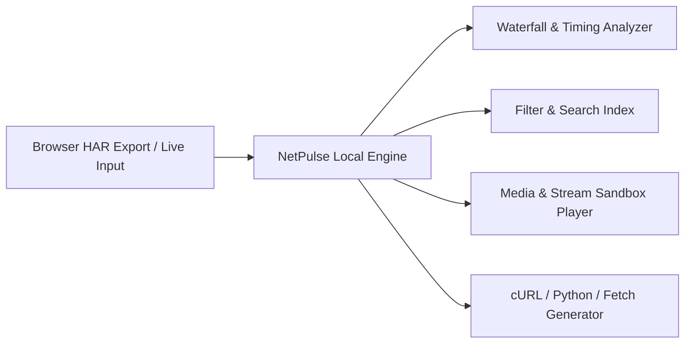

# NetPulse Studio

> Universal Network Waterfall, HAR Log Analyzer & Live Media Stream Inspector.

[](LICENSE)
[](https://tortoche.github.io/netpulse/)
[](#privacy--security)

NetPulse Studio is a production-grade, zero-dependency developer tool designed to inspect HTTP Archive (`.har`) logs, debug live API endpoints, visualize network request waterfalls, and sandbox streaming media (HLS `.m3u8`, DASH, MP4, AAC) directly inside the browser.

Live Web Application: [https://tortoche.github.io/netpulse/](https://tortoche.github.io/netpulse/)

---

## Key Capabilities

- **Client-Side HAR Parser:** Instant parsing of network dumps generated by Chrome, Firefox, Safari, Edge, or Zen browser.
- **Deep Network Inspection:** Exhaustive breakdown of Request and Response Headers, Query Parameters, Cookies, and Response Payloads.
- **Interactive Waterfall Timeline:** Microsecond visualization of DNS resolution, SSL/TLS handshake, TTFB (Time to First Byte), and Content Download.
- **Media Stream Sandbox:** Embedded live video and audio inspector capable of probing HLS manifests, testing segment chunk latencies, and rendering real-time frequency spectrums via the Web Audio API.
- **Code Generator:** Instant conversion of any inspected HTTP request into runnable `cURL`, JavaScript `fetch()`, and Python `requests` snippets.
- **Zero-Server Telemetry:** 100% executed in local memory. Sensitive tokens, cookies, and payloads never leave your browser.

---

## Architecture



---

## Getting Started

### Run in Browser
Visit the official GitHub Pages deployment:
[https://tortoche.github.io/netpulse/](https://tortoche.github.io/netpulse/)

### Local Development
Clone this repository and open `index.html` in any modern web browser:

```bash
git clone https://github.com/Tortoche/netpulse.git
cd netpulse
# Open index.html directly or serve with any static server:
npx serve .
```

---

## License

Distributed under the terms of the [MIT License](LICENSE).
